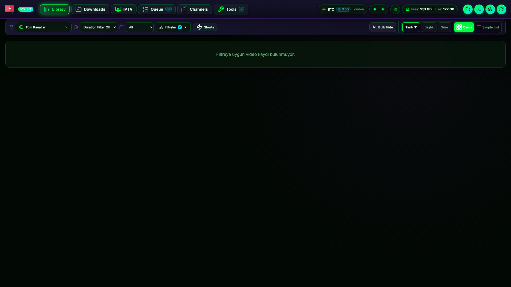
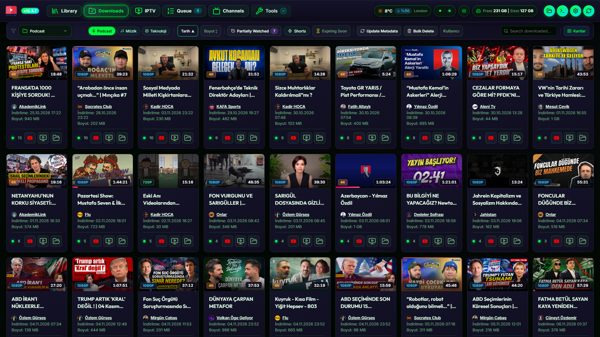
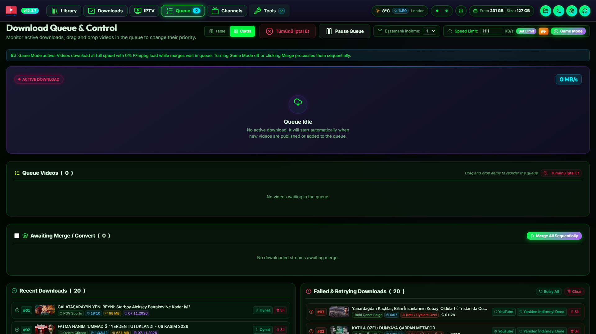
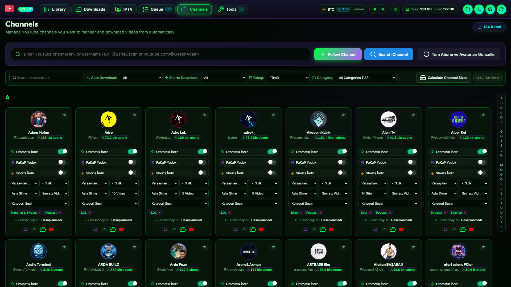
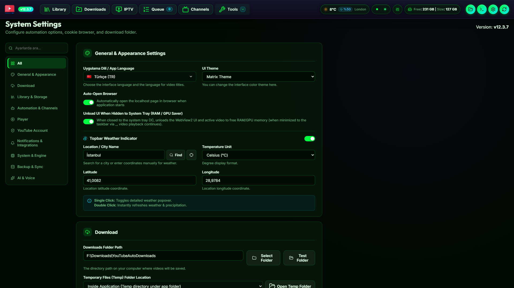
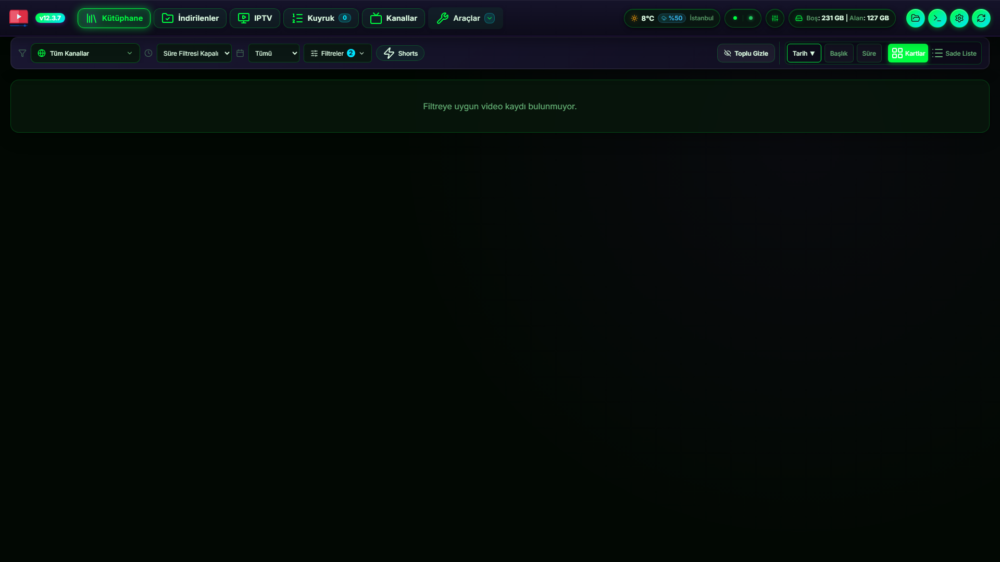
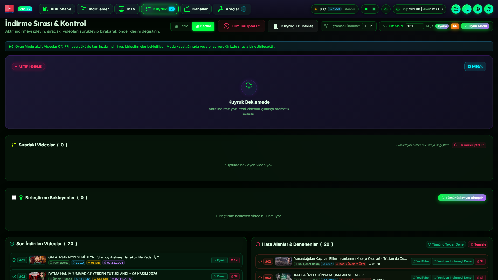
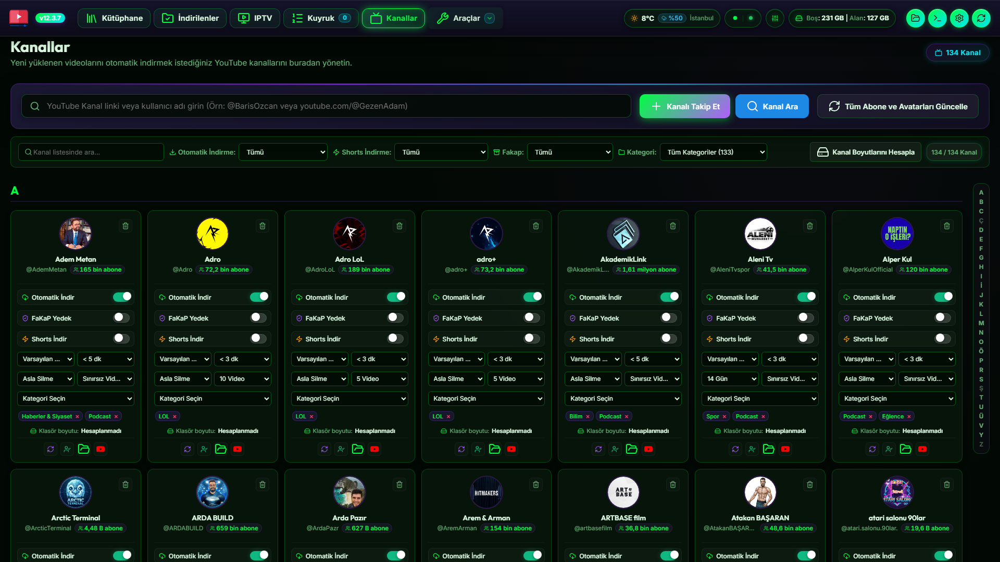
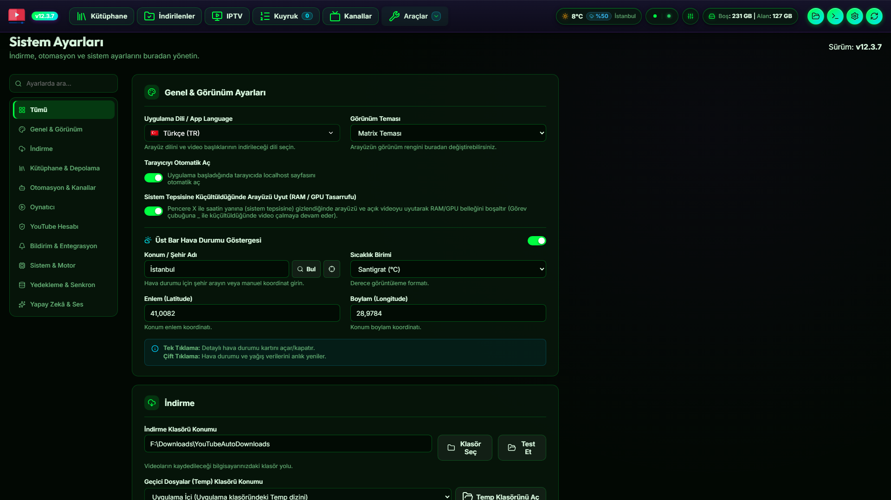

<p align="center">
  
</p>

# <p align="center">📥 Multimedia HaYTooL - Personal YouTube Library & Automation System</p>

<p align="center">
  <b>Portable YouTube Library & Native Player: Follow, Auto-Download & Watch Offline</b><br/>
  <i>YouTube Takip, Otomatik İndirme ve Yerel Oynatıcı: Reklamsız ve Çevrimdışı Kütüphaneniz</i>
</p>

<p align="center">
  <a href="#-english-version"><b>🇬🇧 English Version</b></a> | <a href="#-türkçe-versiyon"><b>🇹🇷 Türkçe Versiyon</b></a> | <a href="https://haytokoraz.github.io/haytool-youtube-download/" target="_blank"><b>🌐 Official Website</b></a> | <a href="https://haytokoraz.github.io/" target="_blank"><b>🌟 All Apps / Tüm Uygulamalar</b></a>
</p>

<p align="center">
  
  
  
  
  <br>
  
  
  
  
  <a href="https://github.com/HaYToKoRaZ/haytool-youtube-download/releases/latest"></a>
  <a href="https://github.com/HaYToKoRaZ/haytool-youtube-download/releases"></a>
  <a href="https://haytokoraz.github.io/" target="_blank"></a>
</p>

---

# 🇬🇧 English Version

## 🎯 Core Philosophy

**Multimedia HaYTooL** is built for users who want to watch their subscriptions without endless algorithmic recommendations and ads. It runs quietly in the background as your private offline video library. You define the exact channels you want to follow. The system continuously runs in the background, monitors their RSS feeds, and automatically downloads new videos as soon as they are uploaded. You watch your chosen content locally, 100% ad-free, offline, and entirely on your own terms.

---

<p align="center">
  <b>📸 Application Screenshots</b>
</p>
<p align="center">
  
  
</p>
<p align="center">
  
  
  
</p>

---

## 🚀 Key Features

* **Background Subscription Automation:** Periodically checks your followed channels via RSS feeds. Downloads new videos automatically the second they are uploaded, creating an offline, local cache of your subscription box.
* **Distraction-Free Feed:** No "Up Next" traps or recommendation rabbit holes. You only see videos published by creators you follow.
* **100% Ad-Free Local Playback:** Plays downloaded videos locally inside a clean dashboard using the built-in media player with smooth seeking, speed control, and responsive controls.
* **SponsorBlock Integration:** Automatically skips sponsor segments, intros, outros, and subscription reminders. Includes a session-based shield toggle button under the player and dimmed segments on the timeline.
* **Advanced Subtitles & Translation:** Automatically grabs English/Turkish subtitles. Features a translation utility supporting 11 target languages with a visual loading overlay, along with customizable subtitle styling (12 colors, 12 background opacities, 13 font sizes).
* **YouTube-Style Split Playlist View:** The "Downloads" tab features a dual-column layout. Watch the active video on the left while browsing your other downloads in a sidebar playlist on the right, supporting autoplay (sequential video playback) and status HUD overlays.
* **Per-Channel Download Rules:** Customize download preferences for each channel individually: toggle auto-download, set duration filters, and allow/restrict downloading vertical YouTube Shorts.
* **Windows System Tray & Interactive Terminal Console:** Runs silently in the background with a Windows Tray Icon. Right-click to navigate, toggle speed limits, or control Discord activity. The console window features a command input field piping stdin controls directly (`ton`, `toff`, `status`, `pd <link>`).
* **Single-Instance Mutex Lock:** Prevents running multiple application processes. Launching a second instance prompts an alert, opens the active dashboard in your browser, and exits.
* **Discord Rich Presence (RPC):** Integrates directly with Discord using Windows Named Pipe IPC to display the watched video's channel name on the `details` line and the video title as the `state`. Can be toggled in settings and tray.
* **Interactive Desktop Notifications (Hero Images & Click-to-Play):** Windows desktop notifications display rich hero banner images of the downloaded video with the HaYTooL application icon. Includes an optional "▶️ Play Now" button via the transparent `haytool://play/{videoId}` protocol that wakes or brings the player window to the front and immediately starts playback.
* **Dual-Boot isolated Configs:** Isolates OS-specific parameters (`configwin.ini` / `configunix.ini`). Prevents file loss on dual-boot setups; missing files are flagged as `fileMissing: true` and automatically restored if they reappear without breaking DB history.
* **Zero-Dependency Startup:** Pre-packaged with `node_modules/`, `yt-dlp/`, and `ffmpeg/`. Works fully out of the box without external setups.
* **APE Tool (Mark as Watched):** Paste any video or channel link to instantly mark videos as watched/hidden in your library and sync them to your real YouTube watch history. Works for followed channels, previously downloaded channels, and even completely foreign channels (fetches the last N videos and marks them in the background, 1-200 adjustable).
* **YouTube Watch History Sync:** While watching locally, your playback position is periodically synced to your actual YouTube watch history (30s interval + on pause/close). Deleting a video with "also mark as watched" uses the real video duration, so YouTube shows it as fully watched — not just appended to history.
* **WebView2 Built-in Cookie System:** Session cookies are captured from the built-in WebView2 player window — no browser extensions or third-party cookie files needed. Use "Sign in to YouTube" from the tray or Settings to log in securely inside the app; cookies are kept alive with automatic background refresh.
* **Web Video & Series Streamer ("Web Watch" Tab):** Dedicated tab with embedded YouTube-style split player layout to watch external video streams directly. Automatically unpacks Dean Edwards packed JavaScript, bypasses betting/ad banners, resolves iframes, and plays HLS (.m3u8) / MP4 streams ad-free with history tracking.
* **Smart Browser Extension Integration:** Chrome/Chromium extension with one-click URL transmission. Right-click any link or page to send it straight to the desktop Multimedia HaYTooL app via Windows foreground IPC bridge, along with instant Turtle speed toggling.

---

## 🛠️ Installation & Running

Since all dependencies (`node_modules/`, `yt-dlp`, `ffmpeg`) are already pre-packaged in the repository, you can run the application immediately after downloading.

For Windows, download the **Windows Setup EXE** for a guided installation, or the **Windows Portable ZIP** to extract and run without installing.
The Setup EXE installs for the current user by default at `%LOCALAPPDATA%\Programs\HaYTooL\Multimedia HaYTooL`; you can choose another location and skip creating a Start Menu folder. Linux releases use the `Multimedia-HaYTooL-v<version>-Linux-<date>.AppImage` naming pattern.
The installer and uninstaller also provide direct links to the HaYTooL website and portal. During uninstall, you can choose whether to remove this installation’s database, cookies, settings, channel/category lists, logs, and backups.

### 
* **Unified Launch (Single Executable):**
  Double-click `Multimedia HaYTooL.exe` in the root folder. It starts the background engine, system tray icon, and opens the native media player window directly (zero-stream lag disk playback, custom WebView2 browser, and full desktop integration in one single lightweight executable).
* **Command Line Launch Options:**
  ```cmd
  :: Standard launch (Starts background server, system tray icon, and player window):
  "Multimedia HaYTooL.exe"

  :: Silent mode (Runs completely in background as a silent service; NO tray icon, NO window):
  "Multimedia HaYTooL.exe" silent
  :: (Also accepts --silent, /silent, -silent, --headless)

  :: Tray-only mode (Minimizes directly to tray without popping up player window):
  "Multimedia HaYTooL.exe" --tray-only
  ```

###  /  (Unix)
1. **Make Launcher Executable:**
   ```bash
   chmod +x baslat.sh
   ```
2. **Start the Application:**
   ```bash
   ./baslat.sh
   ```

Access the dashboard at [http://localhost:4141](http://localhost:4141) *(default port can be changed in Settings)*.

---

## 🎹 Keyboard Shortcuts

When the video player is focused, you can control playback using standard shortcuts:

* **`Space`** or **`k` / `K`**: Play - Pause
* **`f` / `F`**: Toggle fullscreen
* **`m` / `M`**: Mute / Unmute
* **`Arrow Right`**: Seek forward 5s
* **`Arrow Left`**: Seek backward 5s
* **`l` / `L`**: Seek forward 10s
* **`j` / `J`**: Seek backward 10s
* **`Arrow Up`**: Volume +5%
* **`Arrow Down`**: Volume -5%
* **`Home`**: Jump to start
* **`End`**: Jump to end
* **`>`** or **`Shift + .`**: Increase speed (up to 2x)
* **`<`** or **`Shift + ,`**: Decrease speed
* **`0` - `9`**: Jump to video percentage (e.g. 5 jumps to 50%)

---

## 💻 CLI, Console & Taskbar Jump List Commands

You can manage download queues, Game Mode (deferred FFmpeg merge), speeds, launch modes, or UI visibility directly via **`haytool <command>`** (when Windows PATH is active), **`.\haytool <command>`** (or `"Multimedia HaYTooL.exe" <command>`), via the **Windows Taskbar Jump List** (right-click the taskbar icon), or via the interactive Console Input at the bottom of the System Tray log window:

| Command | Arguments | Description | Example |
| :--- | :--- | :--- | :--- |
| `gton` / `gtoff` | - | **Game + Turtle Combo:** Enables or disables both Game Mode and Turtle speed limit at once | `.\haytool gton` |
| `gameon` / `game on` | - | **Game Mode ON:** Downloads at full speed with 0% FFmpeg load; holds merges in queue | `.\haytool gameon` |
| `gameoff` / `game off` | - | **Game Mode OFF:** Disables Game Mode and auto-merges queued streams sequentially | `.\haytool gameoff` |
| `game` | - | Toggles Game Mode on/off (auto-starts sequential merge when turned off) | `.\haytool game` |
| `merge` / `merge-pause` | - | Starts or pauses sequential FFmpeg merging of pending streams on demand | `.\haytool merge` |
| `paste` | - | Reads URL directly from clipboard and adds it to the download queue | `.\haytool paste` |
| `pd` | `[video-url]` | If URL provided: adds video/playlist to queue; If no URL: toggles pause/resume | `.\haytool pd "https://youtu.be/dQw4w9WgXcQ"` |
| `pause` / `resume` | - | Pauses or resumes the active download queue safely | `.\haytool pause` |
| `ton` / `toff` / `toggle` | - | Enables, disables, or toggles Turtle Mode (alternative speed limit profile) | `.\haytool ton` |
| `speed` | `<kb\|off\|on>` | Sets normal speed limit in KB/s, disables (`off`/`0`), or restores last limit (`on`) | `.\haytool speed 2500` |
| `altspeed`| `<kb>` | Sets Turtle Mode speed limit value in KB/s | `.\haytool altspeed 500` |
| `status` / `info` | - | Prints active queue, pending FFmpeg merges, speed limits, and Game/Turtle state | `.\haytool status` |
| `check` / `scan` | - | Instantly triggers full RSS channel scan for newly published videos | `.\haytool check` |
| `backup` / `fakap` | - | Triggers instant system DB backup or runs Fakap retention maintenance | `.\haytool backup` |
| `silent` / `--tray-only` | - | Starts app headless (no tray/window) or minimized directly to system tray | `.\haytool --tray-only` |
| `open` / `hide` / `tray` | - | Restores UI window, hides window to system tray (`hide`/`min`), or shows tray icon | `.\haytool hide` |
| `stop` / `exit` | - | Safely shuts down the background server and terminates the application | `.\haytool stop` |
| `clear` / `help` | - | Clears Tray console log screen or displays full command reference | `.\haytool help` |

**CLI Usage Examples (PowerShell & CMD):**
```powershell
# Enable Game Mode before gaming (1000 Mbps download, 0% FFmpeg CPU/GPU muxing load):
.\haytool gameon

# Disable Game Mode after gaming (automatically merges pending videos one by one):
.\haytool gameoff

# Download the URL currently copied in your clipboard:
.\haytool paste

# Enqueue a specific video or playlist URL:
.\haytool pd "https://www.youtube.com/watch?v=dQw4w9WgXcQ"

# Set normal speed limit to 2500 KB/s, turn it off, or restore last limit:
.\haytool speed 2500
.\haytool speed off
.\haytool speed on

# Enable Turtle Mode (alternative low-speed profile) or check full status:
.\haytool ton
.\haytool status

# Or call the executable directly with quotes:
"Multimedia HaYTooL.exe" check
```

---

## 📂 Configuration Files

* **`configwin.ini`:** Windows-specific parameters (download path, port, alternative speed toggle).
* **`configunix.ini`:** Linux/macOS-specific parameters.
* **`channels.ini`:** Monitored channels list and their download rules.
* **`db.json`:** Lightweight local database storing download history, queue state, and metadata.

---

## 📞 Support & Feedback

* **Main Portal (All Apps):** [haytokoraz.github.io](https://haytokoraz.github.io/)
* **Email:** `korazhayto@gmail.com`
* **X (Twitter):** [HaYTo](https://x.com/HaYTo)
* **GitHub:** [haytool-youtube-download](https://github.com/HaYToKoRaZ/haytool-youtube-download)

*Developer & Designer:* **HaYTo**

---
---

# 🇹🇷 Türkçe Versiyon

## 🎯 Temel Felsefe

**HaYTooL**, YouTube ana sayfasındaki öneri ve reklam döngüsüne girmeden yalnızca istediği içerikleri takip etmek isteyenler için tasarlandı. Arka planda çalışarak aboneliklerinizi bağımsız bir çevrimdışı kütüphaneye dönüştürür. Sadece takip etmek istediğiniz kanalları belirlersiniz; sistem arka planda bu kanalları sürekli tarayarak yeni yüklenen videoları otomatik olarak yerel diskinize indirir. Size sadece kendi kütüphanenizden, reklamsız, çevrimdışı ve özgürce izlemek kalır.

---

<p align="center">
  <b>📸 Uygulama Ekran Görüntüleri</b>
</p>
<p align="center">
  
  
</p>
<p align="center">
  
  
  
</p>

---

## 🚀 Öne Çıkan Özellikler

* **Arka Planda Otomatik Kanal İzleme:** Takip listenizdeki kanalları RSS akışlarıyla sürekli denetler. Yeni bir video yüklenir yüklenmez arka planda otomatik olarak indirerek yerel abonelik kutunuzu oluşturur.
* **Sadece Takip Ettiğiniz Kanallar:** Öneri algoritmaları veya alakasız video tuzakları yok. Yalnızca takip listenize eklediğiniz yayıncıların yeni videolarını görürsünüz.
* **%100 Reklamsız Yerel Oynatım:** İndirilen videoları arayüzdeki yerel oynatıcı üzerinden takılmadan, HTTP 206 Range desteğiyle ve reklamsız olarak doğrudan diskinizden oynatır.
* **SponsorBlock Entegrasyonu:** Video içindeki sponsorlu alanları, intro/outro bölümlerini ve abonelik hatırlatıcılarını otomatik atlar. Oynatıcı altındaki kalkan (shield) butonuyla geçici olarak kapatılabilir.
* **Gelişmiş Altyazı ve Otomatik Çeviri:** İngilizce/Türkçe altyazıları otomatik indirir. Yerleşik çevirici modülüyle altyazıları 11 dile anlık çevirebilir ve altyazı rengini (12 renk), arka plan opaklığını (12 düzey), yazı boyutunu (13 seçenek) özelleştirebilirsiniz.
* **YouTube Tarzı Bölünmüş Çalma Listesi:** İndirilenler sekmesi iki sütunlu yerleşim sunar. Solda aktif video oynatılırken sağda indirilmiş diğer videoların çalma listesi listelenir; otomatik sonraki videoya geçiş (autoplay) ve ortada beliren cam tasarımlı durum HUD'ları desteklenir.
* **Kanala Özel İndirme Kuralları:** Her kanala özel ayarlar sunar: otomatik indirmeyi açıp kapatabilir, dikey Shorts videolarının indirilip indirilmeyeceğini belirleyebilirsiniz.
* **Windows Tepsi Uygulaması & İnteraktif Konsol:** Arka planda sessizce çalışır. Sağ tık menüsüyle hız profillerini, Discord durumunu yönetebilirsiniz. Konsol ekranındaki komut paneli üzerinden sunucuya doğrudan `ton`, `toff`, `status`, `pd <link>` komutları gönderebilirsiniz.
* **Tekil Örnek (Mutex) Koruması:** Uygulamanın birden fazla kez açılmasını engeller. İkinci kez açmaya çalıştığınızda çalışmakta olan portu tespit edip tarayıcıda arayüzü açar ve kendini kapatır.
* **Discord Durumu (Rich Presence) Entegrasyonu:** Windows Named Pipe IPC aracılığıyla izlediğiniz videonun kanal adını `details` satırında, video başlığını ise `state` satırında göstererek Discord profilinizde etkinlik olarak yansıtır.
* **İnteraktif Masaüstü Bildirimleri (Kapak Görseli & Tek Tıkla Oynatma):** Windows bildirimlerinde indirilen videonun yüksek çözünürlüklü kapak görseli (hero image) ve uygulama logosu gösterilir. Ayarlar'dan şeffaf biçimde yönetilebilen `haytool://play/{videoId}` özel protokolü ve "▶️ Hemen Oynat" butonu sayesinde bildirimden tek tıkla uygulama öne getirilip video anında yürütülür.
* **Çift Önyükleme (Dual-Boot) Dosya Koruması:** Windows ve Linux üzerinde ayrı ayar dosyaları (`configwin.ini` / `configunix.ini`) tutar. Diskten silinen dosyaları geçmişten silmeden `fileMissing: true` işaretler ve dosya geri geldiğinde geçmişi bozmadan otomatik onarır.
* **Sıfır Bağımlılık (Zero-Dependency):** Gerekli tüm Node.js modülleri, `yt-dlp` ve `ffmpeg` binary dosyaları depo içinde hazır gelir. Hiçbir harici kuruluma gerek duymadan çift tıklamayla çalışır.
* **APE Aracı (İzlendi Olarak İşaretleme):** Herhangi bir video veya kanal linkini yapıştırarak videoları kütüphanenizde izlendi/gizlendi olarak anında işaretleyin ve gerçek YouTube izleme geçmişinizle eşitleyin. Takip ettiğiniz kanallar, daha önce indirdiğiniz kanallar ve hatta tamamen yabancı kanallar için çalışır (kanalın son N videosu arka planda çekilip işaretlenir, 1-200 arası ayarlanabilir).
* **YouTube İzleme Geçmişi Senkronu:** Videoları yerel oynatıcıda izlerken oynatma konumunuz gerçek YouTube izleme geçmişinize periyodik olarak eşitlenir (30 sn'de bir + durdurma/kapatmada). "YouTube'da da izlendi olarak işaretle" ile silinen videolar gerçek süreleri kullanılarak YouTube'da tamamen izlenmiş olarak gösterilir — yalnızca geçmişe eklenmez.
* **WebView2 Yerleşik Çerez Sistemi:** Oturum çerezleri yerleşik WebView2 oynatıcı penceresinden alınır — tarayıcı eklentisi veya harici çerez dosyası gerekmez. Tepsi veya Ayarlar'daki "YouTube'da Oturum Aç" ile uygulama içinde güvenle oturum açabilirsiniz; çerezler arka planda otomatik yenilemeyle canlı tutulur.
* **Web Video & Dizi Çözücü ("Web İzle" Sekmesi):** Ayrı bir sekme ve yerleşik YouTube tarzı bölünmüş oynatıcı düzeniyle Dizipal, Vidmoly ve popüler dizi/film sitelerindeki şifreli (packed) JS kodlarını ve iframe kaynaklarını çözer; bahis reklam videolarını filtreleyerek akışı doğrudan masaüstü uygulamasında reklamsız oynatır.
* **Akıllı Tarayıcı Eklentisi Entegrasyonu:** Chrome/Chromium tarayıcı eklentisiyle web'de gezinirken tek tıkla veya sağ tık menüsünden herhangi bir sayfayı/linki doğrudan masaüstü Multimedia HaYTooL uygulamasına gönderin; Windows API köprüsüyle uygulama otomatik öne gelerek oynatmayı başlatır. Ayrıca tek tıkla Kaplumbağa hız sınırı yönetimi sunar.

---

## 🛠️ Kurulum ve Çalıştırma

Tüm bağımlılıklar depo içerisinde hazır geldiğinden, indirdikten sonra doğrudan çalıştırabilirsiniz.

Adım adım kurulum için **Windows Setup EXE** dosyasını, kurulum yapmadan çalıştırmak için **Windows Portable ZIP** dosyasını indirin.
Setup EXE uygulamayı varsayılan olarak `%LOCALAPPDATA%\Programs\HaYTooL\Multimedia HaYTooL` konumuna kurar; kurulum yerini değiştirebilir ve Başlat menüsü klasörü oluşturmayı seçmeyebilirsiniz. Linux sürümleri `Multimedia-HaYTooL-v<sürüm>-Linux-<tarih>.AppImage` ad düzenini kullanır.
Kurulum ve kaldırma ekranlarında HaYTooL web sitesi ile portala doğrudan bağlantılar bulunur. Kaldırma sırasında bu kuruluma ait veritabanı, çerez, ayar, kanal/kategori listesi, günlük ve yedekleri silmeyi seçebilirsiniz.

### 
* **Tekil Başlatma (Tek Bir EXE):**
  Kök dizindeki `Multimedia HaYTooL.exe` dosyasına çift tıklayın. Sistem tepsisi simgesi, arka plan sunucusu ve masaüstü yerel oynatıcı penceresi tek bir hafif exe dosyasında birleştirilmiştir. İndirilen videoları diskten doğrudan sıfır gecikmeyle izleyebilirsiniz.
* **Komut Satırı Başlatma Seçenekleri:**
  ```cmd
  :: Standart Başlatma (Arka plan sunucusu, saat yanı tepsi simgesi ve oynatıcı penceresi açılır):
  "Multimedia HaYTooL.exe"

  :: Sessiz (Silent) Mod (Tamamen arka planda sessiz servis olarak çalışır; tepsi simgesi YOK, pencere YOK):
  "Multimedia HaYTooL.exe" silent
  :: (Ayrıca --silent, /silent, -silent, --headless parametreleri de geçerlidir)

  :: Yalnızca Tepsi Modu (Pencere açmadan doğrudan sistem tepsisine simge olarak küçültülmüş başlar):
  "Multimedia HaYTooL.exe" --tray-only
  ```

###  /  (Unix)
1. **Çalıştırma İzni Verin:**
   ```bash
   chmod +x baslat.sh
   ```
2. **Uygulamayı Başlatın:**
   ```bash
   ./baslat.sh
   ```

Arayüze varsayılan olarak [http://localhost:4141](http://localhost:4141) adresinden erişebilirsiniz *(varsayılan port Ayarlar'dan değiştirilebilir)*.

---

## 🎹 Oynatıcı Klavye Kısayolları

Oynatıcı aktifken, aşağıdaki kısayollar ile oynatımı kontrol edebilirsiniz:

* **`Space` (Boşluk)** veya **`k` / `K`**: Oynat - Duraklat
* **`f` / `F`**: Tam ekran modunu aç - kapat
* **`m` / `M`**: Sesi aç - kapat
* **`Yön Tuşu Sağ`**: 5 saniye ileri sar
* **`Yön Tuşu Sol`**: 5 saniye geri sar
* **`l` / `L`**: 10 saniye ileri sar
* **`j` / `J`**: 10 saniye geri sar
* **`Yön Tuşu Yukarı`**: Sesi %5 artır
* **`Yön Tuşu Aşağı`**: Sesi %5 azalt
* **`Home`**: Videonun en başına git
* **`End`**: Videonun en sonuna git
* **`>`** veya **`Shift + .`**: Oynatma hızını artırır (en fazla 2x)
* **`<`** veya **`Shift + ,`**: Oynatma hızını azaltır
* **`0` - `9`**: Videonun belirli bir yüzdesine atlar (Örn: 5 tuşu videonun %50'sine atlar)

---

## 💻 Komut Satırı (CLI), Konsol & Görev Çubuğu (Jump List) Kontrolleri

İndirme kuyruklarını, **Oyun Modunu** (ertelenmiş FFmpeg birleştirme), hız profillerini ve pencere görünürlüğünü **`haytool <komut>`** (Windows PATH aktifken), **`.\haytool <komut>`** kısayoluyla (veya `"Multimedia HaYTooL.exe" <komut>`), **Windows Görev Çubuğu (Taskbar Jump List)** sağ tık menüsünden ya da Sistem Tepsisi log ekranının altındaki konsol satırından doğrudan yönetebilirsiniz:

| Komut | Parametre | Açıklama | Örnek |
| :--- | :--- | :--- | :--- |
| `gton` / `gtoff` | - | **Oyun + Kaplumbağa Birlikte:** Oyun Modu ve Kaplumbağa hız limitini tek komutla açar veya kapatır | `.\haytool gton` |
| `gameon` / `oyunac` | - | **Oyun Modunu Açar:** Tam hızda indirir (%0 FFmpeg yükü), birleştirmeleri kuyrukta bekletir | `.\haytool gameon` |
| `gameoff` / `oyunkapat` | - | **Oyun Modunu Kapatır:** Modu kapatır ve bekleyen videoları otomatik sırayla birleştirir | `.\haytool gameoff` |
| `game` / `oyun` | - | Oyun Modu arasında aç/kapat geçişi yapar (kapatıldığında sırayla birleştirir) | `.\haytool game` |
| `merge` / `merge-pause` | - | Kuyrukta bekleyen FFmpeg birleştirmelerini manuel başlatır veya duraklatır | `.\haytool merge` |
| `paste` / `pano` | - | Panodaki video bağlantısını doğrudan okur ve indirme kuyruğuna ekler | `.\haytool paste` |
| `pd` | `[video-linki]` | Link verilirse kuyruğa ekler; linksiz çağrılırsa duraklat/devam geçişi yapar | `.\haytool pd "https://youtu.be/dQw4w9WgXcQ"` |
| `pause` / `resume` | - | İndirme kuyruğunu duraklatır veya kaldığı yerden devam ettirir | `.\haytool pause` |
| `ton` / `toff` / `toggle` | - | Kaplumbağa Modunu (alternatif düşük hız profilini) açar, kapatır veya değiştirir | `.\haytool ton` |
| `speed` | `<kb\|off\|on>` | Standart hız limitini KB/s ayarlar, kapatır (`off`/`0`) veya son değere geri açar (`on`) | `.\haytool speed 2500` |
| `altspeed`| `<kb>` | Kaplumbağa modu alternatif hız profilini KB/s cinsinden belirler | `.\haytool altspeed 500` |
| `status` / `durum` | - | Aktif kuyruğu, bekleyen birleştirmeleri, hız sınırlarını ve Oyun/Turtle durumunu yazdırır | `.\haytool status` |
| `check` / `tara` | - | Takip edilen tüm kanalları yeni videolar için anında RSS ile denetler | `.\haytool check` |
| `backup` / `fakap` | - | Veritabanı anlık yedeğini alır veya Fakap bakım döngüsünü tetikler | `.\haytool backup` |
| `silent` / `--tray-only`| - | Tamamen sessiz servis modunda veya doğrudan sistem tepsisinde başlatır | `.\haytool --tray-only` |
| `open` / `hide` / `tray` | - | Pencereyi öne getirir, sistem tepsisine gizler (`hide`/`min`) veya simgeyi gösterir | `.\haytool hide` |
| `stop` / `exit` | - | Arka plan sunucusunu ve çalışan uygulamayı güvenle kapatıp sonlandırır | `.\haytool stop` |
| `clear` / `help` | - | Konsol ekranını temizler veya tüm kullanılabilir komut listesini yazdırır | `.\haytool help` |

**CLI Kullanım Örnekleri (PowerShell & CMD):**
```powershell
# Oyuna girmeden önce Oyun Modunu açın (1000 Mbps indirme, %0 FFmpeg birleştirme yükü):
.\haytool gameon

# Oyundan çıkınca Oyun Modunu kapatın (bekleyen videolar otomatik sırayla birleştirilir):
.\haytool gameoff

# Panoya kopyaladığınız bağlantıyı tek komutla indirme kuyruğuna ekleyin:
.\haytool paste

# Doğrudan bağlantı vererek video veya çalma listesi indirin:
.\haytool pd "https://www.youtube.com/watch?v=dQw4w9WgXcQ"

# Normal hız limitini 2500 KB/s yapın, kapatın veya son değere geri açın:
.\haytool speed 2500
.\haytool speed off
.\haytool speed on

# Kaplumbağa modunu açın veya tam sistem durumunu sorgulayın:
.\haytool ton
.\haytool status

# Doğrudan exe adıyla (tırnak içinde) çalıştırma:
"Multimedia HaYTooL.exe" check
```

---

## 📂 Yapılandırma Dosyaları

* **`configwin.ini`:** Windows işletim sisteminde çalışırken kullanılan ayarlar (indirme yolu, port, alternatif hız durumu).
* **`configunix.ini`:** Linux/macOS işletim sistemlerinde çalışırken kullanılan ayarlar.
* **`channels.ini`:** Takip edilen kanalların listesi ve indirme kuralları.
* **`db.json`:** İndirme geçmişi, kuyruk ve veritabanı şablonunu barındıran yerel veritabanı dosyası.

---

## 📞 Destek ve İletişim

* **Ana Portföy & Tüm Uygulamalar:** [haytokoraz.github.io](https://haytokoraz.github.io/)
* **E-posta:** `korazhayto@gmail.com`
* **X (Twitter):** [HaYTo](https://x.com/HaYTo)
* **GitHub:** [haytool-youtube-download](https://github.com/HaYToKoRaZ/haytool-youtube-download)

*Geliştirici & Tasarımcı:* **HaYTo**
